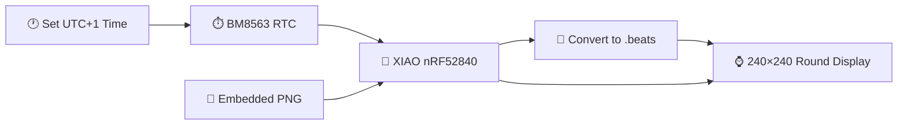
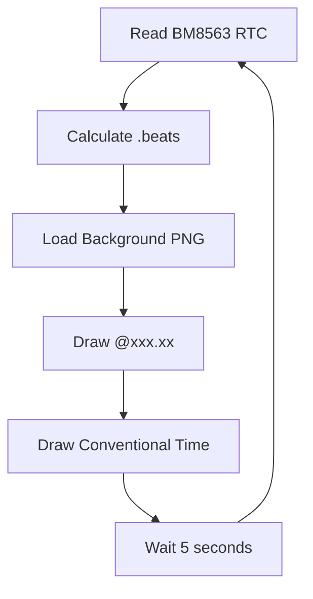

# ⌚ XIAO Round Internet Time

### Swatch Internet Time `.beats` clock with Seeed Studio XIAO nRF52840 and Round Display

[](https://wiki.seeedstudio.com/XIAO_BLE/)
[](https://wiki.seeedstudio.com/get_start_round_display/)
[](https://www.arduino.cc/)
[](LICENSE)

**Roni Bandini — Buenos Aires, Argentina — November 2023**

**XIAO Round Internet Time** is a desktop clock that brings back the late-1990s idea of **Internet Time**: replacing hours and minutes with a universal day divided into **1,000 `.beats`**.

The project is built with a **[Seeed Studio XIAO nRF52840](https://wiki.seeedstudio.com/XIAO_BLE/)** and the **[Seeed Studio Round Display for XIAO](https://wiki.seeedstudio.com/get_start_round_display/)**.

It pays tribute to the story of **Charly Alberti**, drummer of Soda Stereo, who proposed his own Internet-oriented time system called **i-Time** in Argentina in 1998, shortly before Swatch introduced its `.beat` Internet Time concept.

The clock displays:

```text
@458.32
```

instead of a conventional time such as:

```text
12:59
```

---

## ✨ Features

* ⌚ Swatch-style Internet Time display
* 🥁 Tribute to Charly Alberti's 1998 i-Time concept
* 🔢 1,000 `.beats` per day
* 🕐 BM8563 hardware Real Time Clock
* 🖥️ 1.28" circular 240×240 TFT
* 🎨 Embedded PNG graphics
* 🔤 Custom Noto Sans fonts
* 🔋 Battery-compatible Round Display
* 🧱 Custom 3D-printed desktop stand
* 📡 No Internet connection required during operation
* 🔌 XIAO + display plug-and-play hardware

---

# 🕐 What Is Internet Time?

Swatch Internet Time divides a complete day into:

```text
1000 .beats
```

Therefore:

```text
1 day  = 1000 beats
1 beat = 86.4 seconds
```

Examples:

| Conventional time at UTC+1 | Internet Time |
| -------------------------- | ------------: |
| 00:00                      |        `@000` |
| 06:00                      |        `@250` |
| 12:00                      |        `@500` |
| 18:00                      |        `@750` |
| 24:00                      |        `@000` |

Unlike ordinary local time, `.beats` were conceived as a common reference for people communicating through the Internet.

Background:

👉 **[Swatch Internet Time — Wikipedia](https://en.wikipedia.org/wiki/Swatch_Internet_Time)**

---

# 🥁 Charly Alberti and i-Time

In 1998, Argentine musician **Charly Alberti**, drummer of **Soda Stereo**, promoted an Internet-oriented universal time concept called **i-Time**.

The project included a website where users could check the common Internet hour.

This clock was created as a physical tribute to that story, using the circular format of the XIAO display to evoke late-1990s Internet watches.

Full background in Spanish:

👉 **[El Internet Time de Charly Alberti — Medium](https://bandini.medium.com/la-hora-de-internet-de-charly-alberti-f1daabcf1905)**

Project story and construction:

👉 **[The Curious Case of (Swatch?) Internet Time — Hackaday.io](https://hackaday.io/project/193777-the-curious-case-of-swatch-internet-time)**

---

# 🏗️ Architecture



The nRF52840 version does not require Wi-Fi.

Time is entered once before uploading the sketch and then maintained by the **BM8563 RTC integrated into the Round Display**.

---

# 🧮 Calculating `.beats`

The conversion is very simple.

The number of seconds elapsed since midnight in UTC+1 is:

```text
seconds =
    hour × 3600
  + minute × 60
  + seconds
```

Since one `.beat` equals 86.4 seconds:

```text
beats = seconds / 86.4
```

The firmware implements exactly this:

```cpp
float myBeats =
    (
        3600 * timeStruct.hours +
        60 * timeStruct.minutes +
        timeStruct.seconds
    ) / 86.4;
```

For example:

```text
UTC+1 = 03:30:00

(3 × 3600 + 30 × 60) / 86.4

12600 / 86.4

≈ @145.83
```

---

# 🧠 Hardware

| Component                                                                                             | Quantity |
| ----------------------------------------------------------------------------------------------------- | -------: |
| [Seeed Studio XIAO nRF52840](https://wiki.seeedstudio.com/XIAO_BLE/)                                  |        1 |
| [Round Display for XIAO](https://wiki.seeedstudio.com/get_start_round_display/)                       |        1 |
| USB-C cable / power bank                                                                              |        1 |
| [3D-printed stand](https://cults3d.com/en/3d-model/gadget/xiao-round-display-tft-internet-time-stand) | Optional |

No wiring is required between the XIAO and Round Display.

The XIAO simply plugs into the rear connector.

---

# 🧠 XIAO nRF52840

The **[Seeed Studio XIAO nRF52840](https://wiki.seeedstudio.com/XIAO_BLE/)** is based on the Nordic nRF52840.

| Specification  | Value              |
| -------------- | ------------------ |
| CPU            | ARM Cortex-M4F     |
| Clock          | 64 MHz             |
| RAM            | 256 KB             |
| Internal Flash | 1 MB               |
| Onboard Flash  | 2 MB               |
| Wireless       | Bluetooth LE / NFC |
| Size           | 21 × 17.8 mm       |

The project does not use Bluetooth; the board acts as the clock controller and graphics processor.

---

# 🖥️ Round Display for XIAO

The **[Seeed Studio Round Display](https://wiki.seeedstudio.com/get_start_round_display/)** provides most of the hardware required by the project.

| Specification    | Value                    |
| ---------------- | ------------------------ |
| Display          | 1.28" circular TFT       |
| Resolution       | 240 × 240                |
| Colors           | 65K                      |
| Touch            | Capacitive               |
| RTC              | BM8563                   |
| Storage          | TF / microSD up to 32 GB |
| Battery charging | Integrated               |
| Diameter         | 39 mm                    |

The onboard RTC is particularly useful because the XIAO nRF52840 itself does not need to retrieve time from the Internet.

---

# ⏱️ Real Time Clock

Before uploading the sketch, check the current **UTC+1** time:

👉 **[Current UTC+1 time — Time.is](https://time.is/UTC+1)**

Then edit:

```cpp
uint8_t h = 13;
uint8_t m = 44;
uint8_t s = 40;
```

During startup:

```cpp
timeStruct.hours = h;
timeStruct.minutes = m;
timeStruct.seconds = s;

rtc.setTime(&timeStruct);
rtc.begin();
```

Afterwards, the clock reads the BM8563 using:

```cpp
rtc.getTime(&timeStruct);
```

---

# 🔄 Display Loop

The default refresh interval is:

```cpp
int refreshSeconds = 5000;
```

Every five seconds the sketch:

1. Reads the RTC.
2. Calculates `.beats`.
3. Loads the background image.
4. Draws the Internet Time.
5. Draws the conventional UTC+1 time.
6. Waits five seconds.
7. Repeats.



---

# 🎨 Graphics

The repository contains two graphics converted into C header arrays:

* **[`charly.h`](https://github.com/ronibandini/XiaoRoundInternetHour/blob/main/charly.h)** — startup tribute image
* **[`itime.h`](https://github.com/ronibandini/XiaoRoundInternetHour/blob/main/itime.h)** — clock background

The firmware loads them directly from flash:

```cpp
png.openFLASH(
    (uint8_t *)itime,
    sizeof(itime),
    pngDraw
);
```

PNG decoding uses:

👉 **[bitbank2/PNGdec](https://github.com/bitbank2/PNGdec)**

The display background graphics used in the original project were generated with DALL·E and converted into embedded image arrays.

---

# 🔤 Fonts

Two custom Noto Sans fonts are included:

* **[`NotoSansBold15.h`](https://github.com/ronibandini/XiaoRoundInternetHour/blob/main/NotoSansBold15.h)**
* **[`NotoSansBold36.h`](https://github.com/ronibandini/XiaoRoundInternetHour/blob/main/NotoSansBold36.h)**

The larger font displays `.beats`:

```cpp
tft.loadFont(NotoSansBold36);

tft.drawString(
    "@" + String(myBeats),
    40,
    100
);
```

The smaller font displays conventional time near the bottom of the screen.

---

# 📚 Arduino Libraries

Install the following libraries:

### TFT_eSPI

👉 **[Bodmer/TFT_eSPI](https://github.com/Bodmer/TFT_eSPI)**

### I2C BM8563 RTC

👉 **[tanakamasayuki/I2C_BM8563](https://github.com/tanakamasayuki/I2C_BM8563)**

### PNGdec

👉 **[bitbank2/PNGdec](https://github.com/bitbank2/PNGdec)**

### Seeed Arduino Round Display

👉 **[Seeed-Studio/Seeed_Arduino_RoundDisplay](https://github.com/Seeed-Studio/Seeed_Arduino_RoundDisplay)**

Official setup guide:

👉 **[Getting Started with Round Display for XIAO](https://wiki.seeedstudio.com/get_start_round_display/)**

---

# 🚀 Arduino Setup

## 1. Install Arduino IDE

👉 **[Download Arduino IDE](https://www.arduino.cc/en/software)**

## 2. Install XIAO nRF52840 Support

In:

```text
File
→ Preferences
→ Additional Boards Manager URLs
```

add:

```text
https://files.seeedstudio.com/arduino/package_seeeduino_boards_index.json
```

Then:

```text
Tools
→ Board
→ Boards Manager
```

search:

```text
seeed nrf52
```

and install the Seeed nRF52 boards package.

Complete instructions:

👉 **[XIAO nRF52840 Getting Started](https://wiki.seeedstudio.com/XIAO_BLE/)**

---

# 🔧 Display Library Configuration

The original project includes the configuration files required for the Round Display:

* **[`User_Setup_Select.h`](https://github.com/ronibandini/XiaoRoundInternetHour/blob/main/User_Setup_Select.h)**
* **[`lv_conf.h`](https://github.com/ronibandini/XiaoRoundInternetHour/blob/main/lv_conf.h)**

Seeed's Round Display library documents the TFT_eSPI and LVGL configuration here:

👉 **[Seeed Arduino Round Display — GitHub](https://github.com/Seeed-Studio/Seeed_Arduino_RoundDisplay)**

---

# 📥 Download and Upload

Clone:

```bash
git clone https://github.com/ronibandini/XiaoRoundInternetHour.git
cd XiaoRoundInternetHour
```

Repository:

👉 **[github.com/ronibandini/XiaoRoundInternetHour](https://github.com/ronibandini/XiaoRoundInternetHour)**

Open:

👉 **[`itime1.ino`](https://github.com/ronibandini/XiaoRoundInternetHour/blob/main/itime1.ino)**

Set the current UTC+1 time, connect the XIAO nRF52840 and upload.

Serial Monitor runs at:

```text
115200 baud
```

Startup output includes:

```text
Internet Time Beats Clock
with XIAO Round TFT and nrf52840
Roni Bandini, 11/2023
```

---

# 📁 Repository Structure

```text
XiaoRoundInternetHour/
│
├── itime1.ino
├── charly.h
├── itime.h
│
├── NotoSansBold15.h
├── NotoSansBold36.h
│
├── User_Setup_Select.h
├── lv_conf.h
│
├── README.md
└── LICENSE
```

* ⌚ **[`itime1.ino`](https://github.com/ronibandini/XiaoRoundInternetHour/blob/main/itime1.ino)** — main clock firmware
* 🥁 **[`charly.h`](https://github.com/ronibandini/XiaoRoundInternetHour/blob/main/charly.h)** — startup graphic
* 🎨 **[`itime.h`](https://github.com/ronibandini/XiaoRoundInternetHour/blob/main/itime.h)** — Internet Time background
* 🔤 **[`NotoSansBold36.h`](https://github.com/ronibandini/XiaoRoundInternetHour/blob/main/NotoSansBold36.h)** — main font
* 🔧 **[`User_Setup_Select.h`](https://github.com/ronibandini/XiaoRoundInternetHour/blob/main/User_Setup_Select.h)** — TFT configuration
* ⚖️ **[`LICENSE`](https://github.com/ronibandini/XiaoRoundInternetHour/blob/main/LICENSE)** — MIT License

---

# 🧱 3D-Printed Stand

A custom desktop stand was designed for the Round Display and a cylindrical power bank.

It consists of two STL files:

```text
Base.stl
InternetTime.stl
```

The original model was designed for PLA printing.

👉 **[XIAO Round Display TFT Internet Time Stand — Cults3D](https://cults3d.com/en/3d-model/gadget/xiao-round-display-tft-internet-time-stand)**

An alternative is simply mounting the clock on a helping-hands soldering stand for a more industrial appearance.

---

# 🎥 Demo Videos

▶️ **[Internet Time Clock — Build / Demo](https://www.youtube.com/watch?v=Mp1xQuQ7nPs)**

▶️ **[Internet Time / Charly Alberti Background](https://www.youtube.com/watch?v=FyPsmtE1eLw)**

---

# 🌐 External References

## 🔧 Hackaday

Hackaday featured the project in November 2023.

👉 **[Swatch Internet-Time Clock Doesn't Miss A Beat — Hackaday](https://hackaday.com/2023/11/27/swatch-internet-time-watch-doesnt-miss-a-beat/)**

---

## 🛠️ Hackster.io

Hackster covered the XIAO nRF52840 implementation, `.beats`, Round Display, RTC and generated graphics.

👉 **[Roni Bandini's Nordic nRF52840 Desk Clock Brings Back Internet Time — Hackster.io](https://www.hackster.io/news/roni-bandini-s-nordic-nrf52840-desk-clock-brings-back-internet-time-counts-the-beats-of-the-day-6445295e705c)**

---

## ⚡ Hackaday.io

Complete construction tutorial and historical background:

👉 **[The Curious Case of (Swatch?) Internet Time — Hackaday.io](https://hackaday.io/project/193777-the-curious-case-of-swatch-internet-time)**

---

## 🇦🇷 Medium

Spanish-language article about Charly Alberti, i-Time, Swatch and the clock:

👉 **[El Internet Time de Charly Alberti — Medium](https://bandini.medium.com/la-hora-de-internet-de-charly-alberti-f1daabcf1905)**

---

## 🟣 PCBWay

Build article with parts, `.beat` formula, RTC configuration and enclosure:

👉 **[Swatch Retro Internet Time Clock with XIAO Round Display — PCBWay](https://www.pcbway.com/project/shareproject/Internet_Time_Clock_with_Xiao_Round_Display_3279b0e3.html)**

---

## 🌱 Seeed Studio

Hardware documentation:

👉 **[Seeed Studio XIAO nRF52840](https://wiki.seeedstudio.com/XIAO_BLE/)**

👉 **[Round Display for XIAO](https://wiki.seeedstudio.com/get_start_round_display/)**

👉 **[Seeed Arduino Round Display Library](https://github.com/Seeed-Studio/Seeed_Arduino_RoundDisplay)**

---

# 🔗 Related GitHub Projects

### 🏍️ TinyML Tire Care

Machine Learning motion classification using the same XIAO nRF52840 Sense platform.

👉 **[github.com/ronibandini/XIAOnRF52840TireCare](https://github.com/ronibandini/XIAOnRF52840TireCare)**

### 🧬 Game of Life UNO R4

Conway's Game of Life running on the Arduino UNO R4 WiFi onboard LED matrix.

👉 **[github.com/ronibandini/GameOfLifeUNOR4](https://github.com/ronibandini/GameOfLifeUNOR4)**

### ⚽ Soccer Forecast

TinyML soccer forecasting with Arduino UNO R4 Minima and Edge Impulse.

👉 **[github.com/ronibandini/soccerForecast](https://github.com/ronibandini/soccerForecast)**

---

# 📕 Contracultura Maker

**Contracultura Maker** is a book by Roni Bandini about maker culture, experimental electronics, AI, physical computing and technological autonomy.

📂 **[Contracultura Maker — GitHub repository](https://github.com/ronibandini/ContraculturaMaker)**

📕 **[Download Contracultura Maker PDF](https://github.com/ronibandini/ContraculturaMaker/raw/refs/heads/main/ContraculturaMaker2.pdf)**

---

# 📬 Contact

**Roni Bandini**
Maker · AI Developer · Writer
Buenos Aires, Argentina

* 🐙 [GitHub — @ronibandini](https://github.com/ronibandini)
* 🌐 [Medium — @ronibandini](https://bandini.medium.com/)
* 𝕏 [X / Twitter — @RoniBandini](https://x.com/RoniBandini)
* 📸 [Instagram — @ronibandini](https://www.instagram.com/ronibandini/)
* ▶️ [YouTube — @RoniBandini](https://www.youtube.com/@RoniBandini)
* 💼 [LinkedIn — Roni Bandini](https://www.linkedin.com/in/ronibandini/)

---

Built with ⌚ + `.beats` + XIAO + a bit of 1998 Internet history.
